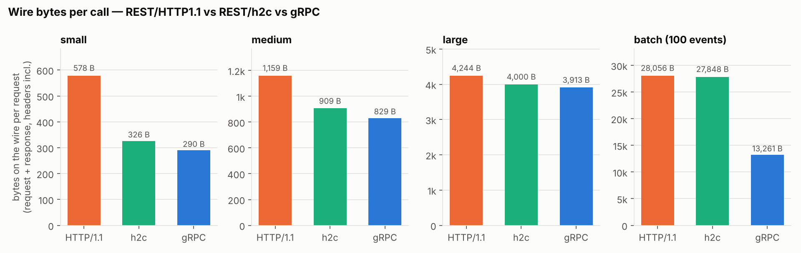
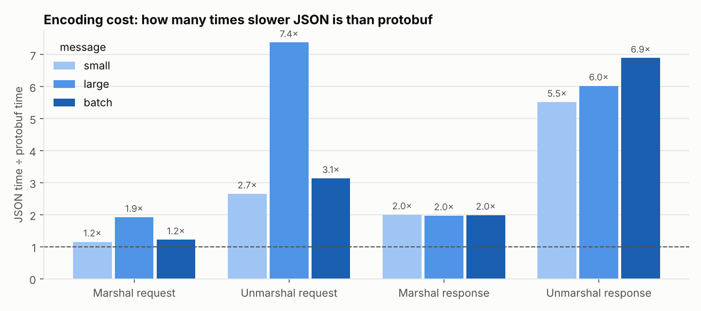
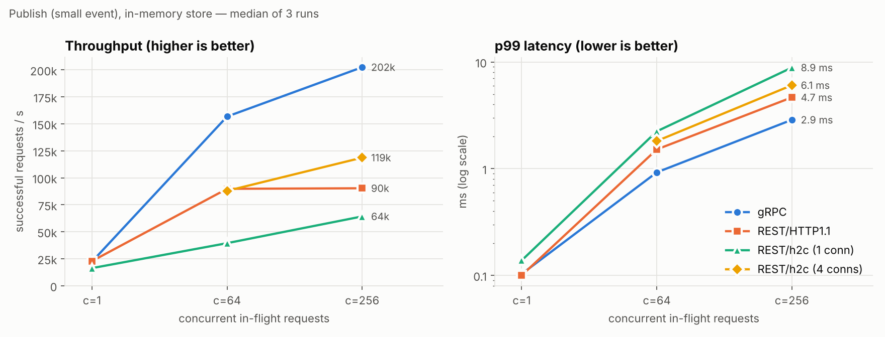
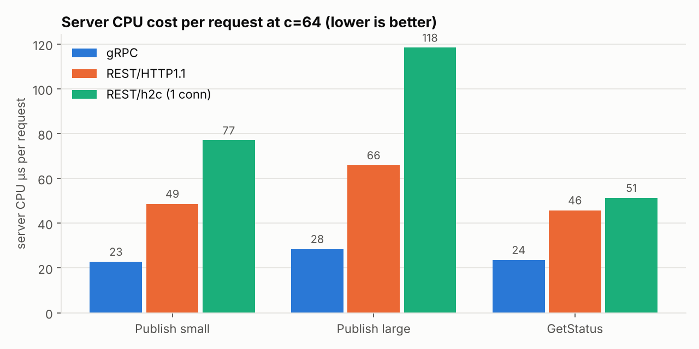
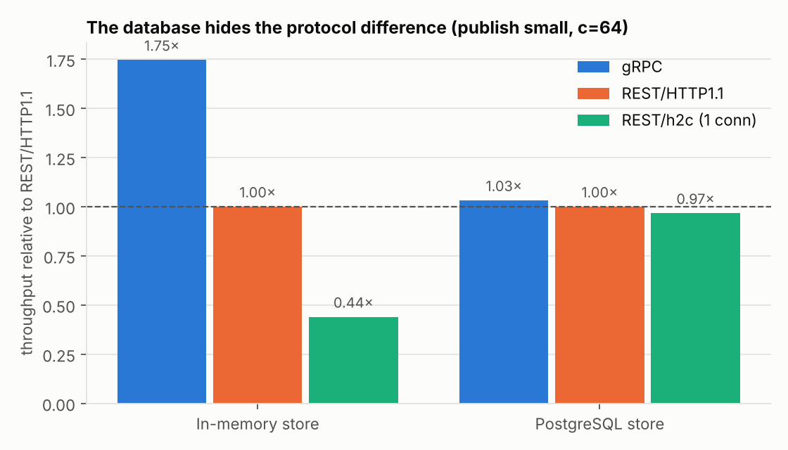

# SIS #2 — Protocol implementation: gRPC vs REST/JSON

**Course:** Backend for Highloaded Environment · KBTU · Fall 2026
**Student:** ____________________
**Service:** notification ingest service (the producer-facing interface designed in SIS #1)

> **Task.** Implement the service interface in Go using the protocol justified in SIS #1, with idempotency, timeouts and retries; measure latency and payload size against a REST/JSON baseline.

---

## 0. Results in one minute

| Question | Answer (median of 3 runs) |
|---|---|
| **Payload size** | A small event costs **290 B** on the wire with gRPC vs **578 B** with REST/HTTP1.1 (**2.0× smaller**). A 100-event batch costs **13.3 KB vs 28.1 KB** (**2.1×**). For a large free-text payload the difference is only **8%**. |
| **Where the bytes go** | For small messages, **headers** dominate: HTTP/2 header compression alone (REST over h2c) cuts 578 → 326 B. For batches, the **body** dominates: protobuf cuts 27.8 → 13.3 KB. |
| **Latency, one request at a time** | No difference for a small event: p99 **103 µs vs 100 µs**. gRPC is faster for larger messages: large p99 **116 vs 155 µs**, batch **681 vs 779 µs**. |
| **Under concurrency** | At c=256, gRPC serves **202k req/s vs 90k (2.2×)** with **p99 2.9 ms vs 4.7 ms**. It uses **22 µs vs 49 µs of server CPU per request (0.44×)**. |
| **With PostgreSQL behind the API** | The protocols are within **3%** of each other (18.0k vs 17.5k req/s at c=64). The database dominates and hides the protocol difference. |
| **At the SIS #1 target load (3,000 events/s)** | All protocols stay far inside the 100 ms ingest SLO: p99 is **0.16–0.18 ms** with the in-memory store and **0.63–0.77 ms** with Postgres. |
| **Idempotency + retries** | When 5% of responses are dropped after the commit, retries hide them (≈5% retries) and **no duplicate rows are ever created**. This is proven by tests, including 50 concurrent identical requests. |
| **Surprise** | REST over HTTP/2 (h2c) is the **slowest** variant on one connection, because of Go's `net/http` HTTP/2 implementation rather than HTTP/2 itself. Four connections fix it (§7.5). |

**Conclusion:** gRPC was the right choice for the producer → notification-service boundary in SIS #1. It is about **2× cheaper in CPU and bandwidth per call**, and the gap matters most for small, frequent internal calls, which is exactly this boundary. Its latency advantage disappears when a database round trip dominates. So the gain is **capacity per server**, not faster individual requests.

---

## 1. What was built

```
producers / loadgen ──► gRPC server (:50051, HTTP/2)        ─┐
                    ──► REST/JSON server (:8080, HTTP/1.1)  ─┼─► service layer ──► store (memory | PostgreSQL)
                    ──► REST/JSON server (:8081, h2c)       ─┘    (one implementation)
```

**One service, three transports.** All business logic lives once in `internal/service`: validation, routing an event type to its channels, idempotency and response building. gRPC and REST are thin adapters that only decode, call the service, and encode. **The only thing that differs between measurements is the protocol stack**, which is what makes the comparison fair.

| Package | Role |
|---|---|
| `proto/notifications/v1` | The contract: `Publish`, `PublishBatch` (≤ 100 events), `GetStatus` |
| `internal/domain`, `internal/service` | Domain types, rules, validation, idempotent publish |
| `internal/store/memory`, `internal/store/postgres` | Store implementations behind one interface (memory for protocol benchmarks, Postgres for real idempotency) |
| `internal/grpcapi`, `internal/httpapi` | Transport adapters, deadline handling, fault injection, health |
| `internal/apierr` | One error-mapping table shared by both transports and both clients |
| `internal/client`, `internal/retry` | gRPC and REST clients with deadlines, retries, full jitter and a retry budget |
| `cmd/server`, `cmd/loadgen`, `cmd/payloadsize`, `cmd/benchsummary` | Server, load generator, payload-size tool, summary tool |

**Why gRPC (from SIS #1):** producers are internal services that we own on both sides, calls are frequent (~3,000 events/s), and we want a typed contract, deadlines that propagate, and HTTP/2 multiplexing. **REST/JSON** (`POST /v1/events`, `POST /v1/events/batch`, `GET /v1/events/{id}`) is the baseline. It is idiomatic REST: standard `encoding/json`, snake_case, enums as strings, `202 Accepted`.

**Error mapping (identical for both protocols):**

| Error | gRPC | HTTP |
|---|---|---|
| invalid input | INVALID_ARGUMENT | 400 |
| unknown event | NOT_FOUND | 404 |
| overload | RESOURCE_EXHAUSTED | 429 |
| temporary failure | UNAVAILABLE | 503 |
| deadline exceeded | DEADLINE_EXCEEDED | 504 |
| client gone | CANCELED | 499 |
| anything else | INTERNAL (generic message, real error only in logs) | 500 |

---

## 2. Idempotency

**The key.** The producer creates `event_id` **once per logical event** and sends the same value on every retry. The helper `client.NewEventID()` uses UUID v7, which is time-ordered and therefore friendly to the B-tree index. A deterministic key such as `order.shipped:<order_id>` also works.

**The mechanism.** The service never checks and then inserts, because two concurrent requests could both pass the check. It inserts with one statement and lets the unique index decide:

```sql
INSERT INTO deliveries (event_id, event_type, user_id, channel, payload, occurred_at)
SELECT e, t, u, c, p::jsonb, o
FROM unnest($1::uuid[], $2::text[], $3::bigint[], $4::text[], $5::text[], $6::timestamptz[]) AS x(e, t, u, c, p, o)
ON CONFLICT (event_id, channel) DO NOTHING
RETURNING event_id, channel, status, attempts;
-- only if fewer rows came back than requested:
SELECT event_id, channel, status, attempts FROM deliveries WHERE event_id = ANY($1::uuid[]);
```

- If two identical requests arrive at the same moment, the second one **waits on the first one's index entry**. When the first commits, the second gets 0 rows, reads the existing rows and returns the **same response**. Only the winner's rows exist.
- Rows are sorted before the insert, so concurrent batches always lock rows in the same order and **cannot deadlock**.
- The schema is deliberately minimal: only `UNIQUE (event_id, channel)`. Index tuning is SIS #3.

**Proof (tests, all with `-race`):**

| Test | Result |
|---|---|
| Same event twice | Identical responses, no extra rows |
| **50 goroutines publish the same event at the same instant** | All 50 responses identical, exactly one row per channel. It passed 30 consecutive runs against Postgres. |
| Same `event_id` twice inside one batch | Identical results, inserted once |
| **Cross-protocol:** REST then gRPC with the same `event_id`, and the reverse | Identical result, one row per channel |
| **Lost responses:** the server commits, then drops 30% of responses; the client retries | All events accepted, **0 duplicate rows**, final result equals `GetStatus` (10/10 stable runs on Postgres) |

**Contract rule (documented, not enforced):** reusing an `event_id` with a *different* event is a producer bug, the same rule Stripe applies to its idempotency keys.

---

## 3. Timeouts

| Where | What |
|---|---|
| **Client** | Each call has a deadline, by default **300 ms** (SIS #1). |
| **gRPC** | The deadline propagates automatically. A server interceptor applies 2 s if none is set and caps it at 5 s. |
| **REST** | The client sends the remaining time as `X-Request-Timeout-Ms`. The server derives the request context from it (2 s default, 5 s cap). |
| **Server work** | The service checks `ctx.Err()` before doing work, and the context is passed into every DB call, so **a cancelled request also cancels its query**. A test with a blocked fake store proves the store sees the cancellation. |
| **HTTP server** | `ReadHeaderTimeout 2s`, `ReadTimeout 5s`, `WriteTimeout 10s`, `IdleTimeout 120s`. |
| **Connections** | REST client idle timeout is **90 s, shorter than the server's 120 s**, to avoid reusing a connection the server already closed (lecture 2). gRPC uses keepalive pings (client 30 s, server enforcement 10 s). |

---

## 4. Retries

**Policy (one implementation shared by both clients):**
- At most 3 attempts, **exponential backoff with full jitter** (`sleep = rand(0, min(1s, 50ms × 2^n))`).
- `Retry-After` / `retry-after-ms` hints are honoured.
- The client **never sleeps past the call deadline**.
- **Same `event_id` on every attempt.**

**What is retried:** `UNAVAILABLE`/503, `RESOURCE_EXHAUSTED`/429, and network errors with no response. **What is not:** invalid argument, not found, internal, and `DEADLINE_EXCEEDED` (the server's deadline is derived from ours, so retrying would always race the caller's own deadline).

**Retry budget:** a token bucket. It starts at 10 tokens; each new call adds 0.1 and each retry costs 1. So under a total outage, retries are capped at about 10% of traffic instead of multiplying the load (lecture 3: retry amplification).

**Fault injection** is server-side and identical for both transports: `FailBefore` (fail without calling the service), `FailAfter` (commit, then drop the response) and added latency.

| Test (200 events, per protocol) | gRPC | REST/1.1 | REST/h2c |
|---|---|---|---|
| FailBefore 30%: attempts / retries / rows | 299 / 99 / 400 | 296 / 96 / 400 | 294 / 94 / 400 |
| **FailAfter 30% on Postgres:** attempts / retries / rows | 286 / 86 / **400** | 274 / 74 / **400** | 280 / 80 / **400** |
| Total outage, 100 calls: retries (budget limit 10 + 100·0.1 = 20) | **20** | **20** | **20** |
| 200 ms server latency, 100 ms call timeout | 1 attempt, `DeadlineExceeded` after ~101 ms | same | same |

The expected number of retries at a 30% failure rate is 200 × 0.3/0.7 ≈ 86, which matches what was measured. 400 rows = 200 events × 2 channels: **no duplicates**.

---

## 5. Measurement methodology

| Item | Choice | Why |
|---|---|---|
| Machine | Apple M4 Pro, 12 cores (8 performance + 4 efficiency), 24 GiB, macOS 15.6.1, Go 1.26.4, PostgreSQL 16.15 in Docker | Recorded in `results/env_final.txt` |
| CPU split | `GOMAXPROCS` 6 for the server, 6 for the load generator | Client and server share one machine; neither should starve the other |
| Harness | **Our own load generator** using the same client library for every protocol | Different tools (ghz vs wrk) behave differently; one harness keeps the comparison fair |
| Runs | 20 s measured after 3 s warm-up, **3 repetitions, median reported** (GetStatus and the three reliability runs: 1 repetition); fresh server per run | Warm-up excludes connection setup; repetitions expose noise |
| Order | Protocols interleaved per configuration, order rotated per repetition | Thermal or background drift affects every protocol equally |
| Latency | HDR histogram, p50/p95/p99 | Averages hide the tail (lecture 1) |
| Closed loop | N workers sending back-to-back (c = 1, 64, 256) | Shows behaviour as concurrency grows |
| Open loop | Fixed arrival rate (3,000 req/s = SIS #1 target), latency measured **from the scheduled send time** | Avoids *coordinated omission* (a slow server otherwise makes the client send less and hides the tail) |
| Timer precision | macOS `time.Sleep` wakes up ~225 µs late, so the open-loop scheduler spins for the last 0.5 ms | Otherwise timer error would be charged to the server |
| Memory store | Capped at 1M events (oldest evicted) | Without a cap, one 35 s batch run needs ~38 GiB, and heap growth would distort later runs |
| CPU | Client CPU via `getrusage`; server CPU via `ps` over the measured window only | CPU per request = efficiency, independent of client speed |
| Variants | gRPC (one HTTP/2 connection, multiplexed); REST/HTTP1.1 (one connection per in-flight request); REST/h2c (one HTTP/2 connection); h2c4 (4 connections) | Each protocol in its idiomatic setup; h2c separates "HTTP/2" from "protobuf" |
| TLS | Off for all protocols | Equal for all; TLS cost would add the same per-connection overhead |

138 runs in total, 0 errors and 0 dropped requests outside the reliability runs, except one REST run (c=256, rep 1) where a single ~300 ms machine stall made 100 calls exceed the 300 ms deadline. The other two repetitions of that configuration were clean, and the median is unaffected.

---

## 6. Payload size

### 6.1 Encoded body (bytes)

| Message | Request proto | Request JSON | JSON/proto | Response proto | Response JSON | JSON/proto |
|---|---:|---:|---:|---:|---:|---:|
| small (`auth.login_code`) | 85 | 159 | 1.87× | 44 | 116 | 2.64× |
| medium (~500 B payload) | 618 | 689 | 1.11× | 50 | 167 | 3.34× |
| large (~3.5 KB payload) | 3,702 | 3,773 | 1.02× | 50 | 167 | 3.34× |
| batch (100 small events) | 8,500 | 16,012 | 1.88× | 4,600 | 11,713 | 2.55× |

### 6.2 On the wire (request + response, headers and framing included, warm connection)



| Message | gRPC | REST/HTTP1.1 | REST/h2c |
|---|---:|---:|---:|
| small | **290 B** | 578 B | 326 B |
| medium | 829 B | 1,159 B | 909 B |
| large | 3,913 B | 4,244 B | 4,000 B |
| batch | **13,261 B** | 28,056 B | 27,848 B |

**Interpretation:**
- **Small messages: the headers are most of the cost.** HTTP/1.1 sends text headers in full on every request. HTTP/2 compresses them with HPACK and reuses a header table per connection. **578 → 326 B comes purely from HTTP/2**; protobuf then saves another 326 → 290 B.
- **Batches: the body is most of the cost.** JSON repeats every field name 100 times; protobuf uses numeric field tags and varints. **27.8 → 13.3 KB comes from protobuf**; HTTP/2 barely helps here.
- **Large free-text payloads: almost no difference** (8%). Protobuf cannot shrink string content; it only avoids field names and quotes.
- gzip would help large JSON a lot (3,773 → 422 B) but makes small messages *larger* (116 → 131 B), and it costs CPU on both sides.

---

## 7. Latency, throughput and CPU

### 7.1 Encoding cost (Go microbenchmarks, median of 10)



| Operation | small proto / JSON | large proto / JSON | batch proto / JSON |
|---|---|---|---|
| Marshal request | 310 / 358 ns | 1,492 / 2,865 ns | 28.2 / 34.4 µs |
| **Unmarshal request** | 405 / 1,075 ns | 1,672 / 12,333 ns | 31.9 / 100.0 µs |
| Marshal response | 68 / 136 ns | 96 / 190 ns | 5.3 / 10.5 µs |
| **Unmarshal response** | 151 / 832 ns | 204 / 1,228 ns | 10.6 / 72.9 µs |

**JSON decoding is the expensive part: 2.7–7.4× slower** than protobuf. Encoding small messages is almost the same (1.2×), because protobuf `map` fields are relatively costly to encode. This explains most of the CPU difference below.

### 7.2 Publish (small event), in-memory store



| c | gRPC | REST/HTTP1.1 | REST/h2c | REST/h2c ×4 conns |
|---|---|---|---|---|
| 1 | 22.3k/s · p99 103 µs | 22.8k/s · p99 100 µs | 16.3k/s · p99 138 µs | – |
| 64 | **156.8k/s · p99 0.92 ms** | 89.8k/s · p99 1.51 ms | 39.4k/s · p99 2.24 ms | 87.9k/s · p99 1.81 ms |
| 256 | **202.5k/s · p99 2.87 ms** | 90.3k/s · p99 4.66 ms | 64.2k/s · p99 8.86 ms | 118.7k/s · p99 6.05 ms |

### 7.3 Larger messages

| Scenario | c | gRPC | REST/HTTP1.1 | gRPC vs REST |
|---|---|---|---|---|
| publish large | 1 | 19.5k/s · p99 116 µs | 15.9k/s · p99 155 µs | 1.23× throughput |
| publish large | 64 | 147.0k/s · p99 1.05 ms | 81.2k/s · p99 2.46 ms | 1.81× |
| publish large | 256 | **176.2k/s · p99 3.04 ms** | 83.1k/s · p99 7.47 ms | **2.12×, p99 0.41×** |
| batch (100 events/call) | 1 | 3.8k calls/s · p99 0.68 ms | 2.5k calls/s · p99 0.78 ms | 1.52× |
| batch | 256 | 14.1k calls/s (1.41M events/s) · p99 28 ms | 12.3k calls/s · p99 64 ms | 1.14×, **p99 0.44×** |
| GetStatus (1 run) | 256 | 177.0k/s · p99 2.08 ms | 93.3k/s · p99 4.15 ms | 1.90× |

### 7.4 CPU per request: the real difference



At c=64 the gRPC server spends **23 µs** of CPU per small publish, versus **49 µs** for REST/HTTP1.1 (28 vs 66 µs for large, 24 vs 46 µs for GetStatus). The client side shows the same ratio (21 vs 49 µs). On this machine both sides are CPU-bound, so **throughput is simply the inverse of CPU per request**. That explains why gRPC reaches ~2× the throughput at high concurrency.

Where the saving comes from:
1. **Cheaper decoding** (§7.1).
2. **Fewer bytes and compressed headers** (§6).
3. **One multiplexed connection with batched writes.** grpc-go's `loopyWriter` collects frames from all concurrent calls into one socket write (§7.5).

**At light load the picture reverses slightly.** At c=1 and in the 3,000 req/s open-loop runs, gRPC uses *more* server CPU per request (41 vs 35 µs at c=1; 84 vs 53 µs at 3,000/s). With one request in flight there is nothing to batch, and gRPC's per-connection goroutines (reader, writer) wake up for every request. *This is our interpretation; we did not profile the light-load case.* gRPC's efficiency advantage appears **under concurrency**, which is the situation a high-load service is designed for.

### 7.5 Investigation: why is REST over HTTP/2 slower than HTTP/1.1?

REST over h2c on one connection was the slowest variant, which seems to contradict "HTTP/2 is better" (lecture 2). We investigated before trusting the number.

**Connection sweep** (publish small, memory; single 30 s runs, except the cells marked ², which are the mean of two 15 s runs):

| h2c connections | c=64 req/s | server CPU/req | c=256 req/s |
|---|---:|---:|---:|
| 1 | 38.3k | 79.5 µs | 62.5k (actually 2 connections¹) |
| 2 | 68.3k² | 61.4 µs | – |
| **4** | **89.3k** | **54.6 µs** | **117.2k²** |
| 8 | 61.4k | 75.8 µs | 72.4k |
| *REST/HTTP1.1 for reference* | 89.8k | 48.6 µs | 89.6k |

¹ Go's HTTP/2 server allows 250 concurrent streams per connection, so at c=256 the client silently opened a second connection (confirmed with `lsof`).
² Mean of two 15 s runs from the connection sweep (they agree within 2%).

**CPU profiles (server, c=64, one connection):**
- **h2c:** about half the samples are in the Go scheduler (`runtime.schedule`), threads parking and waking. Each connection's frames pass through **one** `readFrames` goroutine and **one** `serve` goroutine connected by channels (`selectgo`), and writes go out one batch at a time (`writeFrameAsync` → `bufferedWriter.Flush`). With 64 streams on one connection, the server used only ~3 of its 6 cores.
- **gRPC:** the same HTTP/2 protocol, but grpc-go's `loopyWriter` batches frames from all streams into one `Flush` (≈2.2 µs per request), and reading goes through a buffered framer.
- **Too many connections hurt again:** with 8 connections each `Flush` carries fewer frames, so the write path costs 7.4 → 14.6 → 31.2 µs per request for 1 → 4 → 8 connections.

**Conclusion:** the bottleneck is **per-connection serialisation in Go's `net/http` HTTP/2 implementation, not HTTP/2 itself**. The protocol sets the potential; the implementation decides how much of it you get. With 4 connections, REST over HTTP/2 matches HTTP/1.1 at c=64 and beats it by 31% at c=256. *Limitation: only the server was profiled; the client transport probably has a similar effect.*

### 7.6 With PostgreSQL behind the API



| c | gRPC | REST/HTTP1.1 | REST/h2c |
|---|---|---|---|
| 1 | 2,731/s · p99 527 µs | 2,762/s · p99 529 µs | 2,354/s · p99 655 µs |
| 64 | 18.0k/s · p99 4.83 ms | 17.5k/s · p99 5.08 ms | 16.9k/s · p99 5.10 ms |

Each request now includes a database round trip and an insert (~350 µs at c=1). The protocol share of the total time becomes small, so **gRPC's 1.75× advantage shrinks to 1.03×**. Protocol choice matters most when the handler itself is cheap. Where the database dominates, **SIS #3 (database tuning) is where the latency is won**.

### 7.7 At the SIS #1 target load: 3,000 events/s (open loop)

| Store | gRPC p50 / p99 | REST/HTTP1.1 p50 / p99 | REST/h2c p50 / p99 | Dropped |
|---|---|---|---|---|
| memory | 75 / 156 µs | 73 / 164 µs | 98 / 178 µs | 0 |
| PostgreSQL | 381 / 774 µs | 344 / 631 µs | 380 / 633 µs | 0 |

- **The SIS #1 ingest requirement (p99 < 100 ms) is met with a margin of more than 100×** by every protocol.
- At this rate the server is far from saturated. Latency is dominated by the per-request path (and Postgres), so **the protocols are equivalent here**. The gRPC Postgres p99 varied between 705 and 916 µs across repetitions, which is within run-to-run noise.
- **Capacity:** one instance on a laptop handles ~18k events/s with Postgres at c=64, which is ~6× the target. In SIS #1 terms, gRPC's lower CPU per request means **fewer instances for the same load** once the database is scaled (SIS #3/#4).

### 7.8 Reliability under lost responses (5% dropped after commit, c=64)

| Protocol | req/s | p50 | p99 | Retries | Calls failing all 3 attempts |
|---|---:|---:|---:|---:|---:|
| gRPC | 43.4k | 84 µs | 41.9 ms | 45,652 (5.0%) | 100 |
| REST/HTTP1.1 | 44.4k | 67 µs | 41.5 ms | 46,469 (5.0%) | 123 |
| REST/h2c | 35.7k | 375 µs | 42.4 ms | 37,542 (5.0%) | 83 |

- Retries ≈ the fault rate, as expected. Calls failing all three attempts ≈ 0.05³ × ~870k ≈ 109, matching theory. Those events **were still committed** on the server; at-least-once means the producer will retry them later with the same `event_id`.
- **p99 rises to ~42 ms** because 5% of calls wait in backoff (50 ms base with jitter). That's the deliberate trade-off: retrying immediately would amplify load on a struggling server. It's still far inside the 300 ms deadline.
- Throughput drops because closed-loop workers are sleeping in backoff, not because the server is slower.

---

## 8. Conclusions

1. **gRPC halves the per-call cost**: ~2× fewer bytes for small messages and batches, 2.7–7.4× cheaper decoding, ~0.45× server CPU per request under load. On a CPU-bound server that becomes **~2× throughput and lower tail latency** at high concurrency.
2. **Individual latency is not where gRPC wins.** At c=1 small calls take the same time (~100 µs p99), and behind a database the difference falls to ~3%. The gain is **capacity per server**, which is what a high-load internal boundary needs.
3. **HTTP/2 vs protobuf are separate effects.** HTTP/2 header compression dominates for small messages; protobuf body encoding dominates for batches; neither helps much with large free-text payloads.
4. **Implementation matters as much as protocol.** The same HTTP/2 is ~4× faster on one connection in grpc-go's transport than in `net/http`'s.
5. **Reliability holds:** idempotency by a single `INSERT … ON CONFLICT` makes every retry safe. Concurrent duplicates, cross-protocol retries and lost responses never produce a duplicate row, and the retry budget caps retries at ~10% during an outage.
6. **The decision from SIS #1 stands:** gRPC for producers → notification service; REST/JSON stays appropriate for user-facing apps, where interoperability matters more than CPU per call.

## 9. Limitations

- Client and server share one machine (with performance and efficiency cores), so absolute numbers are machine-specific; the **ratios** are the result.
- Loopback has ~0 network delay, so connection-setup costs and HTTP/2's benefits on real latency are understated.
- TLS is off for all variants.
- The memory store is a single mutex-protected map; at very high throughput it is part of what is measured (equally for all protocols).
- Light-load CPU overhead of gRPC (§7.4) is interpreted, not profiled.
- One REST repetition (c=256) contains a single ~300 ms machine stall (100 timed-out calls); the median excludes its effect.

## 10. Reproduce

```bash
make tools gen               # buf + protoc plugins, generate code
make db-up db-migrate        # PostgreSQL 16 in Docker
make test test-pg            # unit + e2e tests (-race), including Postgres idempotency
make payloadsize             # results/payload_sizes.md|csv
make bench-codec             # results/codec_bench.txt (+ benchstat)
./scripts/bench.sh final     # 138 runs, ~55 min -> results/bench_final_<ts>.csv
make summary SUMMARY_INPUT=results/bench_final_<ts>.csv   # results/summary.md|csv
```

## 11. What comes next

- **SIS #3:** tune PostgreSQL behind the same store interface (indexes, `EXPLAIN ANALYZE`, partitioning, read replica for `GetStatus`, pooling). Reuse this harness for the before/after p95/p99; §7.6 shows that is where latency is now spent.
- **SIS #4:** add a Redis cache and Kafka publishing inside the service layer, deploy to Kubernetes (health endpoints and env config are already in place), load-test with the same `loadgen`.

## 12. Use of AI

*(Required by the course policy. Edit this so it describes exactly what you did.)*

Claude (Anthropic) was used to plan the work, write implementation prompts for Claude Code (which wrote the code under my supervision, phase by phase, with tests at every step), review each phase, and draft this report and its charts from the measured data. I reviewed every design decision and result, and I can explain and defend them without assistance.
